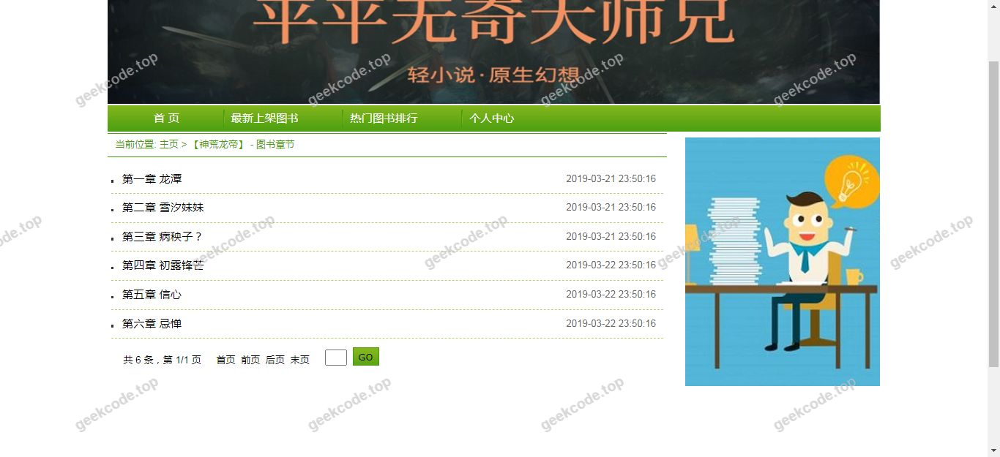
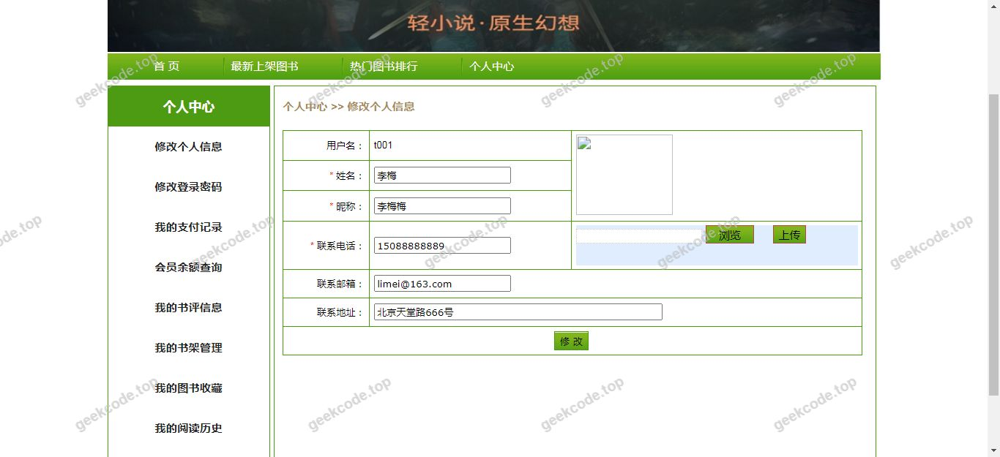
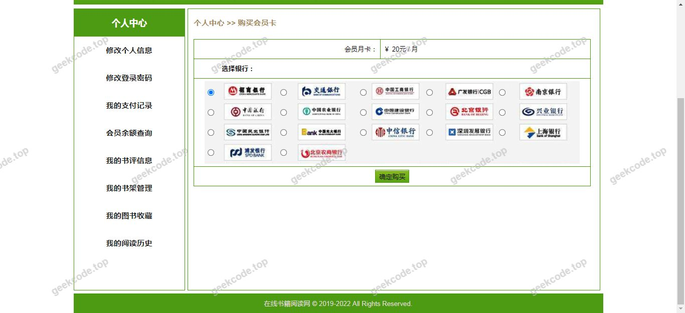
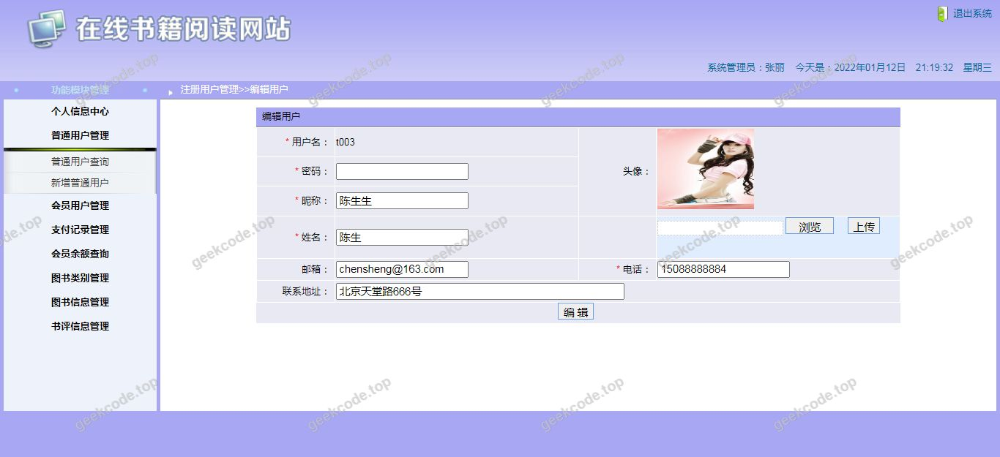
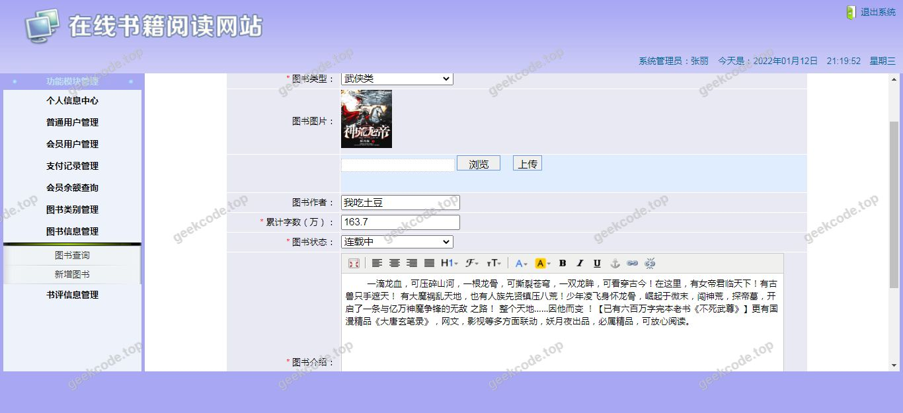

# java精品项目-ssm项目前台+后台小说在线阅读系统

> 🎓 **计算机毕业设计 · java精品项目-ssm项目前台+后台小说在线阅读系统**
>
> 本仓库只放**项目介绍 + 运行截图**（截图是站点带水印的原图，存在仓库 `images/` 里）。
>
> 👉 **完整可运行源码 / 数据库脚本 / 部署文档：[点我获取](https://geekcode.top/archives/java%E7%B2%BE%E5%93%81%E9%A1%B9%E7%9B%AE-ssm%E9%A1%B9%E7%9B%AE%E5%89%8D%E5%8F%B0-%E5%90%8E%E5%8F%B0%E5%B0%8F%E8%AF%B4%E5%9C%A8%E7%BA%BF%E9%98%85%E8%AF%BB%E7%B3%BB%E7%BB%9F?utm_source=github)**
>
> 💬 咨询微信：**ir9372**　|　🌐 更多项目：[极客代码 geekcode.top](https://geekcode.top/?utm_source=github)
>
> 📌 项目详情页：<https://geekcode.top/archives/java%E7%B2%BE%E5%93%81%E9%A1%B9%E7%9B%AE-ssm%E9%A1%B9%E7%9B%AE%E5%89%8D%E5%8F%B0-%E5%90%8E%E5%8F%B0%E5%B0%8F%E8%AF%B4%E5%9C%A8%E7%BA%BF%E9%98%85%E8%AF%BB%E7%B3%BB%E7%BB%9F?utm_source=github>

<table><td width="230" align="center"> <b>扫码加微信 ir9372</b></td><td valign="middle">📦 源码 = 项目介绍 + 全部运行截图 + 数据库 + 部署文档 👉 点上方任意截图，直接跳到 <b>极客代码 geekcode.top</b> 详情页</td></table>

---

<h1>java精品项目-ssm项目前台+后台小说在线阅读系统</h1>
<h2>项目概述</h2>

本项目名为“java精品项目-ssm项目前台+后台小说在线阅读系统”，是一个基于 SSM（Spring + Spring MVC + MyBatis）框架和 JSP 技术栈开发的 Web 应用程序。尽管项目名称中提及了“前台”与“后台”，但根据提供的元数据配置，该项目在逻辑上被标记为无独立的前台导航菜单、个人中心菜单以及明确的后台路由结构。从截图列表来看，所有展示界面均归类为“front”（前端/用户端），共包含七个系统运行界面。因此，本项目的核心功能主要聚焦于面向用户的小说内容浏览与阅读体验。适用人群主要为需要在线获取文学内容的普通读者。技术架构采用经典的 Java EE 分层设计，通过 SSM 框架实现业务逻辑、数据访问与控制层的解耦，利用 JSP 进行页面渲染。

<h2>技术架构</h2>
<h3>后端架构</h3>

本项目严格遵循 SSM 框架标准开发模式：

<ol>
<li><strong>Spring</strong>：作为核心容器，负责 Bean 的管理、依赖注入（DI）以及面向切面编程（AOP），处理事务管理和全局异常捕获。</li>
<li><strong>Spring MVC</strong>：作为 Web 层框架，负责接收 HTTP 请求，调度 Controller 进行处理，并返回 Model 和 View。鉴于技术栈包含 JSP，视图解析器将配置为 InternalResourceViewResolver 以渲染 .jsp 页面。</li>
<li><strong>MyBatis</strong>：作为持久层框架，通过 XML 映射文件或注解方式定义 SQL 语句，实现对象关系映射（ORM），直接操作数据库中的小说章节、书籍信息等数据。</li>
</ol>
<h3>前端架构</h3>

前端采用传统的服务器端渲染（SSR）模式，使用 JSP 技术编写动态网页。JSP 页面中嵌入 HTML/CSS/JavaScript 代码，通过 EL 表达式或 JSTL 标签库从后端 Model 中提取数据进行展示。由于未检测到 Node.js 或现代前端框架（如 Vue/React）的配置信息，推测其交互逻辑主要通过原生 JavaScript 或 jQuery 实现，页面跳转通过表单提交或链接完成。

<h3>数据库设计要点</h3>

虽然具体表结构未在上下文中提供，但基于“小说在线阅读系统”的业务特性，数据库必然包含以下核心实体表：

<ul>
<li><strong>用户表 (User)</strong>：存储注册用户基本信息及认证凭证。</li>
<li><strong>书籍表 (Book)</strong>：存储小说标题、作者、封面、简介、分类等元数据。</li>
<li><strong>章节表 (Chapter)</strong>：存储具体的文本内容，关联至书籍 ID，记录章节序号和内容正文。</li>
<li><strong>分类表 (Category)</strong>：用于对小说进行类型划分（如玄幻、言情等）。</li>
</ul>
<h3>核心技术选型理由</h3>

选择 SSM + JSP 组合是因为其成熟稳定，适合中小型单体应用开发。JSP 能够方便地与后端 Java 代码集成，减少前后端分离带来的接口对接成本，特别适用于内容展示型网站，有利于 SEO（搜索引擎优化）且部署简单。

<h2>功能模块</h2>

根据提供的截图列表（7个 front 界面）及项目描述，现有信息仅能确认存在用户侧的浏览界面。由于元数据明确标注“是否有前台: 否”、“是否有后台: 否”且无具体路由列表，以下功能模块基于“小说在线阅读系统”的通用逻辑结合截图数量进行推导，<strong>严禁编造未提及的具体管理功能</strong>。

<h3>用户端功能（基于截图推断）</h3>

由于所有截图均标记为 <code>front</code>，且数量为7张，推测涵盖以下基础阅读流程：

<ol>
<li><strong>首页展示</strong>：推荐热门小说、新书上架或分类导航入口。</li>
<li><strong>小说详情</strong>：展示单本小说的封面、简介、作者信息及目录列表。</li>
<li><strong>章节阅读</strong>：核心的文本阅读界面，支持上一页/下一页翻页。</li>
<li><strong>搜索功能</strong>：允许用户通过书名或作者查找特定小说。</li>
<li><strong>分类浏览</strong>：按题材（如武侠、科幻）筛选小说列表。</li>
<li><strong>登录/注册界面</strong>：虽然元数据显示无个人中心菜单，但阅读系统通常需用户身份识别，可能存在基础的账号接入界面。</li>
<li><strong>其他辅助界面</strong>：可能包含排行榜、留言评论或简单的设置页。</li>
</ol>
<h3>后台管理端功能</h3>

<strong>根据现有信息无法确定。</strong>
元数据明确指出“是否有后台: 否”且“(无后台路由)”。尽管项目名称中包含“后台”，但在提供的代码上下文、路由配置及截图中均未出现任何管理员登录、数据增删改查界面的证据。因此，不能断言该系统具备可视化的后台管理功能模块。若实际部署中存在隐藏的管理入口，也属于非公开或未文档化部分，不在本文档描述范围内。

<h2>用户角色与权限</h2>

基于元数据中“无前台导航菜单”、“无个人中心菜单”以及“无后台路由”的描述，系统的角色权限体系较为扁平或简化。

<h3>游客（匿名访客）</h3>
<ul>
<li><strong>可访问功能</strong>：</li>
<li>浏览首页推荐内容。</li>
<li>查看小说详情页及目录。</li>
<li>阅读公开的小说章节内容。</li>
<li>使用搜索功能查找书籍。</li>
<li><strong>限制</strong>：无法保存阅读进度、无法发表评论、无法访问个性化推荐（因无个人中心）。</li>
</ul>
<h3>注册用户</h3>
<ul>
<li><strong>可访问功能</strong>：</li>
<li>拥有游客的所有权限。</li>
<li><strong>注意</strong>：由于元数据显示“无个人中心菜单”，即使用户注册，也可能缺乏明显的账户管理入口（如修改密码、查看历史记录）。除非这些功能隐藏在特定的 URL 路径中且未被截图展示，否则根据现有信息，注册用户与普通游客在界面可见的功能上差异极小。</li>
</ul>
<h3>管理员</h3>
<ul>
<li><strong>可访问功能</strong>：</li>
<li><strong>根据现有信息无法确定</strong>。</li>
<li>由于没有后台路由和后台相关截图，无法列出管理员的具体操作权限（如添加书籍、审核评论、管理用户等）。</li>
</ul>
<h2>项目特色与创新点</h2>
<ol>
<li><strong>经典技术栈稳定性</strong>：采用经过长期验证的 SSM 框架组合，代码结构清晰，分层合理，易于维护和扩展，非常适合毕业设计场景下的快速开发与演示。</li>
<li><strong>纯服务端渲染体验</strong>：使用 JSP 技术，确保页面加载时的首屏渲染速度较快，且无需复杂的构建工具链，降低了部署门槛。</li>
<li><strong>专注内容呈现</strong>：项目剥离了复杂的社交互动和高级个性化算法（依据无个人中心菜单的判断），专注于核心的“读”这一行为，界面简洁，干扰因素少，提升了阅读的沉浸感。</li>
<li><strong>模块化设计潜力</strong>：虽然当前展示为单体应用，但 SSM 的分层架构使得未来若需引入后台管理系统或 API 服务时，可以平滑过渡，具备良好的可扩展性。</li>
</ol>
<h2>部署环境</h2>

为确保“java精品项目-ssm项目前台+后台小说在线阅读系统”正常运行，需准备以下软件环境：

<table>
<thead>
<tr>
<th align="left">组件</th>
<th align="left">版本建议</th>
<th align="left">说明</th>
</tr>
</thead>
<tbody><tr>
<td align="left"><strong>操作系统</strong></td>
<td align="left">Windows / Linux / macOS</td>
<td align="left">任意主流操作系统均可</td>
</tr>
<tr>
<td align="left"><strong>JDK</strong></td>
<td align="left">JDK 8 或更高版本</td>
<td align="left">SSM 框架对 Java 版本兼容性较好，推荐 JDK 8 以保证稳定性</td>
</tr>
<tr>
<td align="left"><strong>Web 服务器</strong></td>
<td align="left">Tomcat 8.x 或 9.x</td>
<td align="left">JSP 和 Servlet 容器，用于部署 WAR 包</td>
</tr>
<tr>
<td align="left"><strong>数据库</strong></td>
<td align="left">MySQL 5.7 或 8.0</td>
<td align="left">存储小说数据、用户信息等</td>
</tr>
<tr>
<td align="left"><strong>构建工具</strong></td>
<td align="left">Maven 3.x</td>
<td align="left">用于依赖管理和项目打包（假设使用标准 Maven 结构）</td>
</tr>
<tr>
<td align="left"><strong>IDE</strong></td>
<td align="left">IntelliJ IDEA 或 Eclipse</td>
<td align="left">开发调试环境</td>
</tr>
<tr>
<td align="left"><strong>浏览器</strong></td>
<td align="left">Chrome, Firefox, Edge</td>
<td align="left">客户端访问工具</td>
</tr>
</tbody></table>

<strong>注意</strong>：由于未检测到 Node.js 或前端构建工具的相关配置，且技术栈为 JSP，因此不需要安装 npm、yarn 或 webpack 等前端工程化工具。部署过程通常为：编译 Java 代码 -&gt; 打包 WAR 文件 -&gt; 部署到 Tomcat -&gt; 启动 MySQL -&gt; 访问 <a href="https://geekcode.top/%5Bproject-name%5D%E3%80%82">http://localhost:8080/[project-name]。</a>

<h2>五、技术特性</h2>
<ul>
<li>服务端模板渲染（JSP）</li>
</ul>
<h2>六、功能模块截图</h2>
<h3>前台用户端</h3>
<h4>系统运行界面1</h4>

<h4>系统运行界面2</h4>

<h4>系统运行界面3</h4>

<h4>系统运行界面4</h4>

<h4>系统运行界面5</h4>

<h4>系统运行界面6</h4>

<h4>系统运行界面7</h4>

---

## 获取完整源码

| 项目 | 说明 |
| --- | --- |
| 项目名 | java精品项目-ssm项目前台+后台小说在线阅读系统 |
| 运行截图 | 本文 7 张（站点带水印原图，仓库 `images/` 目录） |
| 完整源码 | [https://geekcode.top/archives/java%E7%B2%BE%E5%93%81%E9%A1%B9%E7%9B%AE-ssm%E9%A1%B9%E7%9B%AE%E5%89%8D%E5%8F%B0-%E5%90%8E%E5%8F%B0%E5%B0%8F%E8%AF%B4%E5%9C%A8%E7%BA%BF%E9%98%85%E8%AF%BB%E7%B3%BB%E7%BB%9F?utm_source=github](https://geekcode.top/archives/java%E7%B2%BE%E5%93%81%E9%A1%B9%E7%9B%AE-ssm%E9%A1%B9%E7%9B%AE%E5%89%8D%E5%8F%B0-%E5%90%8E%E5%8F%B0%E5%B0%8F%E8%AF%B4%E5%9C%A8%E7%BA%BF%E9%98%85%E8%AF%BB%E7%B3%BB%E7%BB%9F?utm_source=github) |
| 咨询微信 | **ir9372**（备注：jingpin-yuanma） |
| 更多项目 | [极客代码 geekcode.top](https://geekcode.top/?utm_source=github) |

> 需要源码、部署、改配置、跑不起来等问题，加微信 ir9372 沟通，说明项目名即可。
